  

 

## Sobre mí

Soy desarrolladora junior de **Mendoza, Argentina**. Empecé en el frontend (HTML, CSS y JavaScript) y hoy estoy dando el salto hacia **Full Stack**: estudio desarrollo backend con **Node.js, Express y MongoDB**.

Me gusta construir cosas que funcionen de punta a punta: una interfaz clara, una API ordenada y una base de datos bien modelada.

> *English: Junior developer from Argentina moving from Frontend to Full Stack, building REST APIs with Node.js, Express and MongoDB.*

## Tecnologías

  

## Proyectos destacados

| Proyecto | Qué es | Tecnologías |
|---|---|---|
| [**dental-clinic-service-manager**](https://github.com/Vanesa-291/dental-clinic-service-manager) | API REST para gestionar servicios y reservas de turnos de una clínica odontológica, con vistas del lado del servidor y actualizaciones en tiempo real. Arquitectura en capas: Router → Controller → Service → Repository → DAO. | Node.js · Express · MongoDB/Mongoose · Socket.io · Handlebars · Zod |
| [**Eunoia**](https://github.com/Vanesa-291/C-Users-vanef-Desktop-proyecto-eunoia) | Sitio web responsive para un emprendimiento de pulseras de macramé hechas a mano en Mendoza. | HTML · CSS · Bootstrap 5 · JavaScript |
| [**Carrito de Compra**](https://github.com/Vanesa-291/Carrito-de-Compra) | Carrito de compras interactivo en el navegador. [Ver demo](https://vanesa-291.github.io/Carrito-de-Compra/) | HTML · CSS · JavaScript |

## Lo que estoy aprendiendo ahora

- Autenticación y autorización en APIs
- Testing automatizado
- Conectar un frontend propio con mis APIs para llegar a proyectos Full Stack completos

<!--
  PARA COMPLETAR CUANDO ESTÉ LISTO (borrá las marcas de comentario):

## Contacto

-->
